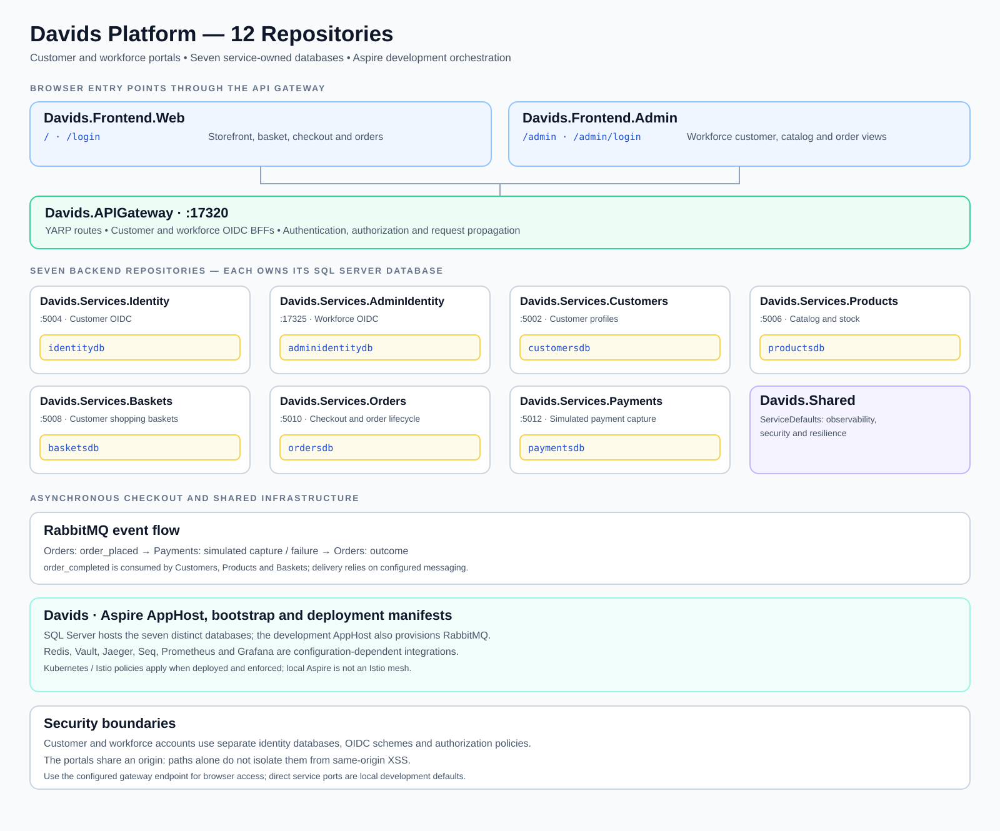

# Davids Services — Aspire Infrastructure

| Security workflow | Status |
|---|---|
| CI — Build, Tests & Security | <a href="https://github.com/dav-Ste/Davids/actions/workflows/pull-request-ci.yml"></a> |
| CodeQL — PR, Main & Weekly | <a href="https://github.com/dav-Ste/Davids/actions/workflows/codeql.yml"></a> |
| Production Cluster — Offline Verification | <a href="https://github.com/dav-Ste/Davids/actions/workflows/production-cluster.yml"></a> |
| Nightly / Manual — DAST & API Fuzzing | <a href="https://github.com/dav-Ste/Davids/actions/workflows/staging-nightly.yml"></a> |
| Quarterly / Post-Release Verification | <a href="https://github.com/dav-Ste/Davids/actions/workflows/quarterly-release.yml"></a> |

This repository owns the `.NET 10` Aspire orchestration, Kubernetes/Istio manifests, and lifecycle security verification tooling for the **Davids** microservices platform:

- Aspire AppHost (`src/Davids.AppHost`)
- Vault KV-v2 OIDC key & BFF secret bootstrap (`src/Davids.Bootstrap`)
- Grafana, Prometheus, Jaeger, and Seq observability configuration (`src/Davids.AppHost/config/grafana`, `deploy/k8s/grafana.yaml`, `deploy/k8s/observability/`)
- Kubernetes, Istio `STRICT` mTLS, Kyverno, Falco, and Cilium Tetragon manifests (`deploy/k8s/`)
- SQL Server baseline scripts (`database/`) and PowerShell setup, build, test, database, and security runners (`scripts/`)

## Contents

- [Orchestrated repositories & live CI status](#orchestrated-repositories--live-ci-status)
- [Architecture, project relationships & security posture](#architecture-project-relationships--security-posture)
- [Repository layout](#repository-layout)
- [First-time setup](#first-time-setup)
- [Local ports & endpoints at a glance](#local-ports--endpoints-at-a-glance)
- [Infrastructure credentials and how to access them](#infrastructure-credentials-and-how-to-access-them)
- [Run and test](#run-and-test)
- [Persistence and database isolation](#persistence-and-database-isolation)
- [Component responsibilities](#component-responsibilities)
- [Security workflow names and schedules](docs/SECURITY-SCAN-WORKFLOW-UPDATE.md)
- [Security gates by lifecycle stage](#local-dev--commit-security-gates-securitylocal-dev-commit--scriptssecuritylocal-dev-commit)
  - [Local Dev / Commit](#local-dev--commit-security-gates-securitylocal-dev-commit--scriptssecuritylocal-dev-commit)
  - [Pull Request CI](#pull-request-ci-security-gates-securitypull-request-ci--scriptssecuritypull-request-ci)
  - [Staging / Nightly DAST](#staging--nightly-dast-security-gates-securitystaging-nightly--scriptssecuritystaging-nightly)
  - [Quarterly / Release](#quarterly--release-security-gates-securityquarterly-release--scriptssecurityquarterly-release)
  - [Production Cluster](#production-cluster-runtime-mesh-supply-chain--login-audit-alerting-securityproduction-cluster-deployk8s--scriptssecurityproduction-cluster)
- [Validation and limitations](#validation-and-limitations)

## Orchestrated repositories & live CI status

Each component lives in its own standalone repository with an independent `.slnx` solution (`Davids.slnx` here is the aggregate development solution). Every badge below updates automatically from live GitHub Actions runs on `main`:

| Repository | Pull Request CI | CodeQL SAST |
|---|---|---|
| **[`Davids`](https://github.com/dav-Ste/Davids)** | <a href="https://github.com/dav-Ste/Davids/actions/workflows/pull-request-ci.yml"></a> | <a href="https://github.com/dav-Ste/Davids/actions/workflows/codeql.yml"></a> |
| **[`Davids.Shared`](https://github.com/dav-Ste/Davids.Shared)** | <a href="https://github.com/dav-Ste/Davids.Shared/actions/workflows/pull-request-ci.yml"></a> | <a href="https://github.com/dav-Ste/Davids.Shared/actions/workflows/codeql.yml"></a> |
| **[`Davids.Services.Identity`](https://github.com/dav-Ste/Davids.Services.Identity)** | <a href="https://github.com/dav-Ste/Davids.Services.Identity/actions/workflows/pull-request-ci.yml"></a> | <a href="https://github.com/dav-Ste/Davids.Services.Identity/actions/workflows/codeql.yml"></a> |
| **[`Davids.Services.AdminIdentity`](https://github.com/dav-Ste/Davids.Services.AdminIdentity)** | <a href="https://github.com/dav-Ste/Davids.Services.AdminIdentity/actions/workflows/pull-request-ci.yml"></a> | <a href="https://github.com/dav-Ste/Davids.Services.AdminIdentity/actions/workflows/codeql.yml"></a> |
| **[`Davids.Services.Customers`](https://github.com/dav-Ste/Davids.Services.Customers)** | <a href="https://github.com/dav-Ste/Davids.Services.Customers/actions/workflows/pull-request-ci.yml"></a> | <a href="https://github.com/dav-Ste/Davids.Services.Customers/actions/workflows/codeql.yml"></a> |
| **[`Davids.Services.Products`](https://github.com/dav-Ste/Davids.Services.Products)** | <a href="https://github.com/dav-Ste/Davids.Services.Products/actions/workflows/pull-request-ci.yml"></a> | <a href="https://github.com/dav-Ste/Davids.Services.Products/actions/workflows/codeql.yml"></a> |
| **[`Davids.Services.Baskets`](https://github.com/dav-Ste/Davids.Services.Baskets)** | <a href="https://github.com/dav-Ste/Davids.Services.Baskets/actions/workflows/pull-request-ci.yml"></a> | <a href="https://github.com/dav-Ste/Davids.Services.Baskets/actions/workflows/codeql.yml"></a> |
| **[`Davids.Services.Orders`](https://github.com/dav-Ste/Davids.Services.Orders)** | <a href="https://github.com/dav-Ste/Davids.Services.Orders/actions/workflows/pull-request-ci.yml"></a> | <a href="https://github.com/dav-Ste/Davids.Services.Orders/actions/workflows/codeql.yml"></a> |
| **[`Davids.Services.Payments`](https://github.com/dav-Ste/Davids.Services.Payments)** | <a href="https://github.com/dav-Ste/Davids.Services.Payments/actions/workflows/pull-request-ci.yml"></a> | <a href="https://github.com/dav-Ste/Davids.Services.Payments/actions/workflows/codeql.yml"></a> |
| **[`Davids.APIGateway`](https://github.com/dav-Ste/Davids.APIGateway)** | <a href="https://github.com/dav-Ste/Davids.APIGateway/actions/workflows/pull-request-ci.yml"></a> | <a href="https://github.com/dav-Ste/Davids.APIGateway/actions/workflows/codeql.yml"></a> |
| **[`Davids.Frontend.Admin`](https://github.com/dav-Ste/Davids.Frontend.Admin)** | <a href="https://github.com/dav-Ste/Davids.Frontend.Admin/actions/workflows/pull-request-ci.yml"></a> | <a href="https://github.com/dav-Ste/Davids.Frontend.Admin/actions/workflows/codeql.yml"></a> |
| **[`Davids.Frontend.Web`](https://github.com/dav-Ste/Davids.Frontend.Web)** | <a href="https://github.com/dav-Ste/Davids.Frontend.Web/actions/workflows/pull-request-ci.yml"></a> | <a href="https://github.com/dav-Ste/Davids.Frontend.Web/actions/workflows/codeql.yml"></a> |

### Repository roles and isolation

| Repository | Role & Isolation Boundary | Default Port |
|---|---|---|
| **[`Davids`](https://github.com/dav-Ste/Davids)** | `.NET 10` Aspire AppHost, Vault bootstrap, K8s/Istio manifests & aggregate security suite | Aspire Dashboard |
| **[`Davids.Shared`](https://github.com/dav-Ste/Davids.Shared)** | `Davids.ServiceDefaults` (`OpenTelemetry`, `Serilog`, `DataProtection`, `/health`, resilience) | Shared library / NuGet |
| **[`Davids.Services.Identity`](https://github.com/dav-Ste/Davids.Services.Identity)** | Customer OpenIddict `7.7.2` `RS256` OIDC Provider & CIAM (`identitydb`, `role: user`) | `:5004` |
| **[`Davids.Services.AdminIdentity`](https://github.com/dav-Ste/Davids.Services.AdminIdentity)** | Workforce OpenIddict `7.7.2` `RS256` OIDC Provider (`adminidentitydb`, `admin`/`support`/`auditor`) | `:17325` |
| **[`Davids.Services.Customers`](https://github.com/dav-Ste/Davids.Services.Customers)** | Customer profiles, self-service & order tracking (`customersdb`, public JWKS only — zero signing keys) | `:5002` |
| **[`Davids.Services.Products`](https://github.com/dav-Ste/Davids.Services.Products)** | Seeded product catalog, live pricing & warehouse stock ledger (`productsdb`, public JWKS only) | `:5006` |
| **[`Davids.Services.Baskets`](https://github.com/dav-Ste/Davids.Services.Baskets)** | Customer server-side shopping basket with live catalog price/stock verification (`basketsdb`) | `:5008` |
| **[`Davids.Services.Orders`](https://github.com/dav-Ste/Davids.Services.Orders)** | Customer checkout, order lifecycle & RabbitMQ completion saga (`ordersdb`) | `:5010` |
| **[`Davids.Services.Payments`](https://github.com/dav-Ste/Davids.Services.Payments)** | Simulated asynchronous RabbitMQ payment capture & workforce payment ledger (`paymentsdb`, zero raw PANs) | `:5012` |
| **[`Davids.APIGateway`](https://github.com/dav-Ste/Davids.APIGateway)** | YARP `2.3.0` edge reverse proxy & dual Admin/Customer OIDC BFFs (zero signing keys) | `:17320` |
| **[`Davids.Frontend.Admin`](https://github.com/dav-Ste/Davids.Frontend.Admin)** | Workforce RBAC (`admin`/`support`/`auditor`) customer, catalog, order, IAM & audit UI | `:17321` |
| **[`Davids.Frontend.Web`](https://github.com/dav-Ste/Davids.Frontend.Web)** | Customer Storefront, Basket, Checkout, Orders & Self-Service Portal (`CustomerBffCookie` via `/`) | `:17322` |

Authentication uses **Self-Hosted .NET OpenID Connect (`OpenIddict` `7.7.2`)** with **OAuth 2.1 Authorization Code + PKCE (`S256`)**, asymmetric **RS256** signing keys, public JWKS discovery (`/.well-known/openid-configuration` & `/.well-known/jwks`), single-use rotating refresh tokens with reuse detection, RFC 7009 revocation synced to Redis, and **two isolated Gateway OIDC Backend-for-Frontend (BFF) cookies** (`davids_admin_bff` for workforce employees `admin`/`support`/`auditor` on `Davids.Frontend.Admin` and `davids_customer_bff` for customers on `Davids.Frontend.Web`). Resource servers (`Customers`, `Products`, `Baskets`, `Orders`, `Payments`, and `Davids.APIGateway`) hold **zero signing keys**.

Persistence uses **SQL Server** with seven separately owned databases (typically hosted on the same SQL Server instance):

- Customer accounts and customer OpenIddict grants (`identitydb`)
- Administrator accounts and admin OpenIddict grants (`adminidentitydb`)
- Customer profiles and completed-order tracking (`customersdb`)
- Seeded product catalog, pricing, stock, and catalog change audits (`productsdb`)
- Customer shopping baskets (`basketsdb`)
- Customer orders, line items, and checkout outbox (`ordersdb`)
- Asynchronous payment capture ledger (`paymentsdb`)

## Architecture, project relationships & security posture



- **Pre-rendered vector diagram**: [`docs/architecture-and-security.svg`](docs/architecture-and-security.svg)
- **Editable diagram document (topology, OIDC PKCE/BFF sequence diagram, security lifecycle overview & PNG/SVG export commands)**: [`docs/ARCHITECTURE-AND-SECURITY-DIAGRAM.md`](docs/ARCHITECTURE-AND-SECURITY-DIAGRAM.md)
- **Standalone Mermaid diagram source (`mmdc` / Mermaid Live Editor ready)**: [`docs/architecture-and-security.mmd`](docs/architecture-and-security.mmd)
- **Continuous security testing & hardening playbook**: [`docs/SECURITY-TESTING-PLAYBOOK.md`](docs/SECURITY-TESTING-PLAYBOOK.md)

## Repository layout

Clone this infrastructure repository and the sibling repositories into the **same parent directory**:

```text
<workspace>/
  Davids/                          # this repository; Aspire + Davids.slnx
  Davids.Shared/                   # shared Davids.ServiceDefaults + Davids.Shared.slnx
  Davids.Services.Identity/        # Customer OIDC Provider & CIAM (identitydb, role: user) + Davids.Services.Identity.slnx
  Davids.Services.AdminIdentity/   # Workforce OIDC Provider (adminidentitydb, admin/support/auditor) + Davids.Services.AdminIdentity.slnx
  Davids.Services.Customers/       # customer profiles + customersdb
  Davids.Services.Products/        # catalog and stock + productsdb
  Davids.Services.Baskets/         # shopping baskets + basketsdb
  Davids.Services.Orders/          # checkout and order lifecycle + ordersdb
  Davids.Services.Payments/        # simulated payment capture + paymentsdb
  Davids.APIGateway/               # YARP edge gateway + dual OIDC BFFs + Davids.APIGateway.slnx
  Davids.Frontend.Admin/           # Workforce Admin Web frontend + Davids.Frontend.Admin.slnx
  Davids.Frontend.Web/             # Customer Self-Service Web Portal + Davids.Frontend.Web.slnx
```

`Davids.AppHost` references ten application hosts by relative path:

- `Davids.Services.Identity` (`identity`)
- `Davids.Services.AdminIdentity` (`admin-identity`)
- `Davids.Services.Customers` (`customers`)
- `Davids.Services.Products` (`products`)
- `Davids.Services.Baskets` (`baskets`)
- `Davids.Services.Orders` (`orders`)
- `Davids.Services.Payments` (`payments`)
- `Davids.APIGateway` (`api-gateway`)
- `Davids.Frontend.Admin` (`frontend-admin`)
- `Davids.Frontend.Web` (`frontend-web`)

The application hosts use `Davids.ServiceDefaults` from the sibling `Davids.Shared` repository. Component repositories have their own solutions; see each component README for its standalone dependencies and configuration.

## First-time setup

Prerequisites:

- .NET 10 SDK
- Git
- PowerShell 7 (or Windows PowerShell 5.1+)
- A Docker-compatible container runtime

Clone `Davids` and pull the 11 sibling repositories into the same parent workspace directory (replace `dav-Ste` if cloning from your own fork):

```powershell
git clone https://github.com/dav-Ste/Davids.git
Set-Location Davids
./scripts/Get-Projects.ps1 -GitHubOwner dav-Ste
./scripts/Setup.ps1
./scripts/Start.ps1
```

> **Windows downloaded `.zip` note (Mark of the Web):** If you extracted the workspace from a browser-downloaded `.zip` instead of cloning via `git`, Windows stamps a `Zone.Identifier` stream onto `.ps1` scripts and `.config\dotnet-tools.json` (causing PowerShell security prompts and blocking `dotnet tool restore`). Do **not** globally weaken PowerShell execution policy; instead, unblock the archive before extracting (`Unblock-File .\Davids-Workspace.zip`) or unblock the extracted workspace folder once:
> ```powershell
> Get-ChildItem -Path 'C:\Apps\Davids-workspace' -Recurse -File -Force | Unblock-File
> ```
> (`Setup.ps1` also accepts `-Unblock` or can prompt to unblock the `Davids*` folders if `Zone.Identifier` is detected.)

`Get-Projects.ps1` clones the sibling repositories into the parent workspace folder:

- `Davids.Shared`
- `Davids.Services.Identity`
- `Davids.Services.AdminIdentity`
- `Davids.Services.Customers`
- `Davids.Services.Products`
- `Davids.Services.Baskets`
- `Davids.Services.Orders`
- `Davids.Services.Payments`
- `Davids.APIGateway`
- `Davids.Frontend.Admin`
- `Davids.Frontend.Web`

To fast-forward clean Git checkouts later, run `./scripts/Update-Projects.ps1`.

Open `Davids.slnx` to work on Aspire and all 47 projects together (including Solution Items for build props, workflows, Kubernetes manifests, and security configs), or open a focused vertical `.slnx` slice that keeps `Davids.AppHost` loaded for `F5` debugging:

- `solutions/Davids.Orchestration.slnx` (`AppHost`, `Bootstrap`, and `AppHost.Tests`)
- `solutions/Davids.AdminVertical.slnx` (`AppHost`, `Bootstrap`, `ServiceDefaults`, `APIGateway`, `AdminIdentity`, `Products`, `Orders`, `Payments`, and `Frontend.Admin`)
- `solutions/Davids.CustomerVertical.slnx` (`AppHost`, `Bootstrap`, `ServiceDefaults`, `APIGateway`, `Identity`, `Customers`, `Products`, `Baskets`, `Orders`, `Payments`, and `Frontend.Web`)

Or open any standalone component solution:

- `../Davids.Shared/Davids.Shared.slnx`
- `../Davids.Services.Identity/Davids.Services.Identity.slnx`
- `../Davids.Services.AdminIdentity/Davids.Services.AdminIdentity.slnx`
- `../Davids.Services.Customers/Davids.Services.Customers.slnx`
- `../Davids.Services.Products/Davids.Services.Products.slnx`
- `../Davids.Services.Baskets/Davids.Services.Baskets.slnx`
- `../Davids.Services.Orders/Davids.Services.Orders.slnx`
- `../Davids.Services.Payments/Davids.Services.Payments.slnx`
- `../Davids.APIGateway/Davids.APIGateway.slnx`
- `../Davids.Frontend.Admin/Davids.Frontend.Admin.slnx`
- `../Davids.Frontend.Web/Davids.Frontend.Web.slnx`

## Local ports & endpoints at a glance

| Resource / Service | Aspire Resource Name | Container / Default Port | Key Paths & Health Probes |
|---|---|---|---|
| **API Gateway & Dual OIDC BFFs** | `api-gateway` | `:17320` | `/`, `/login`, `/admin`, `/admin/login`, `/auth/session`, `/customer-auth/session`, `/gateway-info`, `/health` |
| **Admin Web Frontend** | `frontend-admin` | `:17321` *(proxied via `:17320/admin`)* | `/admin` (workforce RBAC `admin`/`support`/`auditor` via Gateway), `/health` |
| **Customer Web Portal** | `frontend-web` | `:17322` *(proxied via `:17320/`)* | `/`, `/login` (`CustomerBffCookie` via Gateway), `/health` |
| **Admin Identity OIDC Provider** | `admin-identity` | `:17325` | `/.well-known/openid-configuration`, `/.well-known/jwks`, `/change-audits`, `/health` |
| **Customers API** | `customers` | `:5002` | `/customers`, `/customers/me`, `/customers/change-audits`, `/health` |
| **Customer Identity OIDC Provider** | `identity` | `:5004` | `/.well-known/openid-configuration`, `/.well-known/jwks`, `/sign-up`, `/me/change-audits`, `/health` |
| **Products API** | `products` | `:5006` | `/products`, `/products/admin`, `/products/change-audits`, `/health` |
| **Baskets API** | `baskets` | `:5008` | `/baskets/me`, `/baskets/me/items`, `/health` |
| **Orders API** | `orders` | `:5010` | `/orders/checkout`, `/orders/me`, `/orders`, `/health` |
| **Payments API** | `payments` | `:5012` | `/payments/me`, `/payments`, `/health` |
| **SQL Server** (seven databases) | `sql` | `:1433` | `identitydb`, `adminidentitydb`, `customersdb`, `productsdb`, `basketsdb`, `ordersdb`, `paymentsdb` |
| **Redis** (revoked JTI cache) | `cache` | `:6379` | TCP |
| **RabbitMQ** (broker + Management UI) | `messaging` | `:5672` / `:15672` | AMQP + Management UI |
| **HashiCorp Vault** (KV-v2 secrets) | `vault` | `:8200` | `/v1/sys/health`, `/ui` |
| **Prometheus** (OTLP metrics + rules) | `prometheus` | `:9090` | `/api/v1/otlp/v1/metrics`, `/alerts` |
| **Jaeger** (UI + OTLP traces) | `jaeger` | `:16686` / `:4318` | Jaeger UI (`:16686`), `/v1/traces` (`:4318`) |
| **Grafana** (dashboards & Unified Alerting) | `grafana` | `:3000` | `/api/health`, pre-provisioned Prometheus & Jaeger datasources |
| **Seq** (structured CLEF security audit logs) | `seq` | `:80` | Web UI & `/api/events/raw?clef` |

Default application ports above come from local launch settings; Aspire dashboard endpoints are authoritative. Container ports need not equal host ports. Redis, Vault, Jaeger, Seq, Prometheus and Grafana are configuration-dependent integrations. Production cluster resources and Istio policies are separate from the development AppHost.

## Infrastructure credentials and how to access them

No passwords, tokens, RSA private keys, or OIDC client secrets are hardcoded in source control. Secrets are either provisioned upfront by `./scripts/Setup.ps1` or generated automatically on first run by `.NET Aspire` (`persist: true` parameter defaults) and saved in the AppHost's local `.NET user-secrets` store (`UserSecretsId: davids-identity-apphost`).

### Inspecting credentials from the CLI or Aspire Dashboard

1. **Via .NET CLI** (from the `Davids` repository root, after running `./scripts/Setup.ps1` and starting the AppHost at least once so Aspire persists auto-generated container passwords):
   ```powershell
   dotnet user-secrets list --project src/Davids.AppHost
   ```
2. **Via the Aspire Dashboard** (printed in console output by `./scripts/Start.ps1`):
   - Open the **Resources** tab, click **View** (**Details**) on a resource row (for example `messaging`, `sql`, `cache`, or `vault`), and click the reveal (eye) icon next to the password/token environment variable or connection string; or inspect the corresponding parameter row (`messaging-password`, `sql-password`, `cache-password`, `vault-dev-root-token`, `dev-admin-password`, `admin-oidc-bff-client-secret`).

### Credential reference by resource

- **RabbitMQ (`messaging`)**
  - **Management UI**: Click the `management` HTTP endpoint link on the `messaging` row in the Aspire Dashboard (maps to container port `15672`; AMQP broker runs on container port `5672`).
  - **Username**: `guest`
  - **Password**: Stored in user-secrets as `Parameters:messaging-password` (created automatically by Aspire on first startup) and visible in the Aspire Dashboard on `messaging` under `RABBITMQ_DEFAULT_PASS` (or parameter `messaging-password`).
- **SQL Server (`sql` — hosts the seven service databases)**
  - **Endpoint**: Host port shown on the `sql` row's `tcp` endpoint in the Aspire Dashboard (maps to container port `1433`).
  - **Username**: `sa`
  - **Password**: Stored in user-secrets as `Parameters:sql-password` (created automatically by Aspire on first startup) and visible in the Aspire Dashboard on `sql` under `MSSQL_SA_PASSWORD` (or parameter `sql-password`).
- **Redis (`cache`)**
  - **Endpoint**: Host port shown on the `cache` row's `tcp` endpoint in the Aspire Dashboard (maps to container port `6379`).
  - **Username**: None (standard Redis password-only authentication / `default` ACL user).
  - **Password**: Stored in user-secrets as `Parameters:cache-password` (created automatically by Aspire on first startup) and visible in the Aspire Dashboard on `cache` under `REDIS_PASSWORD` (or parameter `cache-password`).
- **HashiCorp Vault (`vault`)**
  - **UI / HTTP API**: Click the `http` endpoint on the `vault` row in the Aspire Dashboard (maps to container port `8200`).
  - **Authentication method**: `Token`
  - **Root token (development)**: Generated by `./scripts/Setup.ps1` and stored in user-secrets as `Parameters:vault-dev-root-token` (also visible in the Aspire Dashboard on `vault` under `VAULT_DEV_ROOT_TOKEN_ID`).
- **Seeded Administrator Account (`Davids.Frontend.Admin` & `Davids.Services.AdminIdentity`)**
  - **Sign-in URL**: `<api-gateway-http-endpoint>/admin/login` (triggers OIDC Authorization Code + PKCE SSO via `/auth/login` -> `/admin-identity/connect/authorize`).
  - **Email (username)**: `admin@davids.local` (configured via `SeedAdmin:Email` in `src/Davids.AppHost/appsettings.json` when `Integrations:SeedAdmin=true`).
  - **Password**: Generated by `./scripts/Setup.ps1` and stored in user-secrets as `Parameters:dev-admin-password`.
- **OIDC Asymmetric RSA Keys & Confidential BFF Secret (Vault bootstrap)**
  - **Customer Identity RSA keys**: Generated as distinct 2048-bit PKCS#8 RSA private keys by `./scripts/Setup.ps1` (`Parameters:oidc-signing-key` and `Parameters:oidc-encryption-key`) and seeded into Vault KV v2 at `secret/data/davids/identity` (`Oidc:SigningKeyPem`, `Oidc:EncryptionKeyPem`). Public verification keys are served dynamically at `/identity/.well-known/jwks`.
  - **Admin Identity RSA keys**: Generated as distinct 2048-bit PKCS#8 RSA private keys by `./scripts/Setup.ps1` (`Parameters:admin-oidc-signing-key` and `Parameters:admin-oidc-encryption-key`) and seeded into Vault KV v2 at `secret/data/davids/admin-identity` (`Oidc:SigningKeyPem`, `Oidc:EncryptionKeyPem`). Public verification keys are served dynamically at `/admin-identity/.well-known/jwks`.
  - **Confidential Admin BFF Client Secret (`davids-admin-bff`)**: Generated by `./scripts/Setup.ps1` as `Parameters:admin-oidc-bff-client-secret` and seeded into `secret/data/davids/admin-identity` (`Oidc:BffClientSecret`) and `secret/data/davids/gateway` (`AdminOidc:BffClientSecret`). Neither `Davids.APIGateway` nor `Davids.Services.Customers` (`secret/data/davids/customers`) ever receives or stores JWT signing keys.
  - **ASP.NET Core Data Protection Key-Ring Wrapping Keys**: Generated automatically on first AppHost startup (persisted in user-secrets as `Parameters:identity-dataprotection-key`, `Parameters:admin-identity-dataprotection-key`, and `Parameters:gateway-dataprotection-key`) and seeded into each service's isolated Vault KV-v2 path (`DataProtection:MasterKey`). Each service encrypts its persistent key ring at rest with AES-256-GCM (HKDF-SHA256 + service-bound AEAD `AAD`) or X.509 PEM certificates (`DataProtection:CertificatePem` + `DataProtection:CertificateKeyPem`).
- **Grafana (`grafana`)**
  - **Local Aspire development**: Anonymous Admin access is enabled (`GF_AUTH_ANONYMOUS_ENABLED=true`) — open the `grafana` `http` endpoint from the Aspire Dashboard directly with no username or password required.
  - **Kubernetes / Istio deployment (`deploy/k8s/grafana.yaml`)**: Anonymous access is disabled; credentials are stored in the `grafana-admin-credentials` Kubernetes `Secret` (`admin-user` and `admin-password` keys) in the `davids` namespace:
    ```powershell
    kubectl -n davids get secret grafana-admin-credentials -o jsonpath='{.data.admin-user}' | ForEach-Object { [Text.Encoding]::UTF8.GetString([Convert]::FromBase64String($_)) }
    kubectl -n davids get secret grafana-admin-credentials -o jsonpath='{.data.admin-password}' | ForEach-Object { [Text.Encoding]::UTF8.GetString([Convert]::FromBase64String($_)) }
    ```
- **Local Observability UIs without authentication in Development**
  - **Seq (`seq`)**: Open the `http` endpoint from the Aspire Dashboard (`SEQ_FIRSTRUN_NOAUTHENTICATION=true`; no login required locally).
  - **Jaeger (`jaeger`)**: Open the `ui` endpoint from the Aspire Dashboard (no login required locally).
  - **Prometheus (`prometheus`)**: Open the `http` endpoint from the Aspire Dashboard (no login required locally).
  - **InfluxDB 3 Core (`influxdb`, opt-in via `Integrations:InfluxDB=true`)**: Started with `--without-auth` for local development.
  - **Elasticsearch & Kibana (`elasticsearch` / `kibana`, opt-in via `Integrations:Elasticsearch=true`)**: Started with `xpack.security.enabled=false` for local development.

## Run and test

```powershell
./scripts/Start.ps1
```

Open the Aspire dashboard URL printed by the AppHost and use the **API Gateway** endpoint (default `http://localhost:17320`) for browser access:

- **Customer storefront:** `/`; an unauthenticated protected page redirects to `/login`. Browse products, manage a basket, check out and view orders.
- **Workforce portal:** `/admin`; an unauthenticated browser request redirects to `/admin/login`, which starts the admin OIDC flow through `/auth/login`. Workforce access is subject to the relevant `admin`, `support` or `auditor` policy; customers cannot use workforce-only endpoints.
- The direct frontend ports are development resource endpoints, not replacements for the gateway's authenticated entry points. API clients receive authorization responses rather than browser login pages.

Both portals share the same origin in this configuration. Their paths and separate cookies are not an isolation boundary against same-origin XSS. Logout and token revocation depend on the configured identity and revocation services.

Build and test the complete composition or a single standalone component:

```powershell
./scripts/Build.ps1
./scripts/Test.ps1
./scripts/Test.ps1 -Category Unit
./scripts/Test.ps1 -Category Integration
./scripts/security/local-dev-commit/Verify-Dependencies.ps1

dotnet restore ../Davids.Services.AdminIdentity/Davids.Services.AdminIdentity.slnx --locked-mode
dotnet build   ../Davids.Services.AdminIdentity/Davids.Services.AdminIdentity.slnx --no-restore -c Release
dotnet test    ../Davids.Services.AdminIdentity/Davids.Services.AdminIdentity.slnx --no-build --no-restore -c Release
```

For the live OIDC discovery, Customer PKCE, RabbitMQ outbox, and Admin OIDC BFF smoke test, retrieve `Parameters:dev-admin-password` via `dotnet user-secrets list --project src/Davids.AppHost` and pass the `api-gateway` endpoint URL from the Aspire dashboard (or your Kubernetes/Istio gateway):

```powershell
./scripts/Test-Infrastructure.ps1 `
  -GatewayUrl 'http://localhost:<api-gateway-port>' `
  -AdminEmail 'admin@davids.local' `
  -AdminPassword '<dev-admin-password>'
```

## Persistence and database isolation

Each service owns a distinct SQL Server database. `identitydb` and `adminidentitydb` separate customer and workforce accounts; a single SQL Server instance may host all seven databases.

- `identitydb` — customer accounts, OIDC grants, audit records and messaging tables.
- `adminidentitydb` — workforce accounts, OIDC grants and audit records.
- `customersdb` — customer profiles and completed-order tracking.
- `productsdb` — seeded product catalog, pricing, stock and change audits.
- `basketsdb` — customer baskets.
- `ordersdb` — checkout, order lifecycle and messaging tables.
- `paymentsdb` — simulated payment transactions and messaging tables; no raw card numbers are stored.

Aspire configures migrations for its local development resources. To generate idempotent SQL scripts for **all seven contexts**, run:

```powershell
./scripts/Update-Database.ps1 -GenerateSql
```

The currently checked-in baseline files are `database/identity.sql`, `database/admin-identity.sql` and `database/customers.sql`. The command also generates `products.sql`, `baskets.sql`, `orders.sql` and `payments.sql`; review the generated scripts before using them.

To apply all migrations explicitly, provide **all seven** connection strings first:

```powershell
$env:ConnectionStrings__identitydb = '<Customer Identity SQL Server connection string>'
$env:ConnectionStrings__adminidentitydb = '<Admin Identity SQL Server connection string>'
$env:ConnectionStrings__customersdb = '<Customers SQL Server connection string>'
$env:ConnectionStrings__productsdb = '<Products SQL Server connection string>'
$env:ConnectionStrings__basketsdb = '<Baskets SQL Server connection string>'
$env:ConnectionStrings__ordersdb = '<Orders SQL Server connection string>'
$env:ConnectionStrings__paymentsdb = '<Payments SQL Server connection string>'
./scripts/Update-Database.ps1
```

The script applies contexts sequentially and checks each connection string as it reaches that context. If a later value is missing or a migration fails, earlier databases may already have been updated; the operation is not one transaction across all seven databases.

## Component responsibilities

- **Shared Host Defaults** (`Davids.Shared`)
  - Standalone shared library (`Davids.ServiceDefaults`)
  - `/health` and `/alive` probes
  - Trusted `ForwardedHeadersMiddleware` (`ForwardedHeaders:KnownProxies` and `ForwardedHeaders:KnownNetworks` CIDR allowlists, disabled safely when no proxies are configured so untrusted callers cannot spoof `X-Forwarded-For`)
  - Isolated ASP.NET Core Data Protection encryption-at-rest (`AesGcmDataProtectionXmlEncryptor` with HKDF-SHA256 + service-bound AEAD `AAD`, or X.509 certificate wrapping via `DataProtection:CertificatePem` + `DataProtection:CertificateKeyPem`, failing closed in `Production` if persistent storage or encryption is missing)
  - OpenTelemetry metrics, distributed tracing, and logging exporters
  - `Microsoft.Extensions.ServiceDiscovery` HTTP client defaults
  - Optional Serilog sinks (Seq, rolling files, and Elasticsearch)
- **Customer Identity OIDC Provider** (`Davids.Services.Identity`)
  - Self-hosted `OpenIddict` (`7.7.2`) OIDC authority for customer accounts (`role: user` only) in `identitydb`
  - OAuth 2.1 Authorization Code + PKCE (`S256`) for public client `davids-web`
  - Asymmetric RS256 JWTs (`aud: davids-services`, Vault `secret/data/davids/identity`) and public `/.well-known/jwks`
  - Single-use rotating refresh tokens (`14 day` lifetime) with zero-leeway replay detection, per-client-IP rate limiting + per-account failed-login lockout (`Lockout:MaxFailedAccessAttempts` / `Lockout:DurationMinutes`), and RFC 7009 Redis revocation (`davids:identity:revoked:<jti>`)
  - `POST /sign-up` and transactional RabbitMQ outbox (including `signed_up` and `email_changed`)
- **Admin Identity OIDC Provider** (`Davids.Services.AdminIdentity`)
  - Self-hosted `OpenIddict` (`7.7.2`) OIDC authority for workforce accounts (`admin`, `support`, `auditor`) in `adminidentitydb`
  - OAuth 2.1 Authorization Code + PKCE (`S256`) for confidential BFF client `davids-admin-bff`
  - Asymmetric RS256 JWTs (`aud: davids-admin`, `15 min` lifetime, Vault `secret/data/davids/admin-identity`) and public `/.well-known/jwks`
  - Single-use rotating refresh tokens (`8 hour` lifetime) with replay revocation, per-client-IP authentication rate limits, per-account failed-login lockout (`Lockout:MaxFailedAccessAttempts` / `Lockout:DurationMinutes`), and RFC 7009 Redis revocation (`davids:admin-identity:revoked:<jti>`)
  - Workforce-authorized `GET /users`, admin-only `POST /users`, and development-only `SeedAdmin`
- **Customers** (`Davids.Services.Customers`)
  - SQL-backed customer profiles in `customersdb`
  - Zero-shared-secret dual-authority RS256 OIDC JWKS validation (`CustomerBearer` and `AdminBearer`)
  - Workforce search and filtering (`GET /customers?search=&state=&vip=`)
  - Workforce customer profile editing (`PUT /customers/{customerId}`) and state transitions (`PUT /customers/{customerId}/state/{state}`)
  - VIP qualification after 20 distinct completed orders
  - RabbitMQ inbox consumers for identity and order events
- **Products** (`Davids.Services.Products`)
  - Catalog and inventory in `productsdb`; local Aspire enables the product seed.
  - Public catalog reads and workforce-authorized catalog and stock management.
- **Baskets** (`Davids.Services.Baskets`)
  - Customer-owned shopping baskets in `basketsdb`, with product price and stock verification.
- **Orders** (`Davids.Services.Orders`)
  - Checkout and customer/workforce order views in `ordersdb`; payment outcome events drive the order lifecycle.
- **Payments** (`Davids.Services.Payments`)
  - Simulated asynchronous capture and payment records in `paymentsdb`; this is not a real payment-provider integration. Raw PANs are not stored.
- **API Gateway & OIDC BFF** (`Davids.APIGateway`)
  - YARP edge enforcing zero-shared-secret dual-authority RS256 JWKS authentication (`CustomerBearer` and `AdminBearer`)
  - Confidential OIDC BFF (`AddOpenIdConnect` + PKCE `S256` + `davids_admin_bff` encrypted `HttpOnly` cookie, Vault `secret/data/davids/gateway`) with automatic server-side refresh rotation, RFC 7009 logout revocation, and `X-Requested-With: DavidsAdmin` and an `Origin` check when the header is present
  - Workforce-policy gating on `Davids.Frontend.Admin` (`302 /admin/login` for anonymous HTML; API responses depend on the matched policy)
  - Configurable Redis revocation checks for both identity domains
  - Per-client-IP edge rate limiting (`gateway-admin-auth`, `gateway-customer-auth`, `gateway-api`) with `Retry-After` responses and anti-spoofing `X-Forwarded-For` overwrite (`"X-Forwarded": "Set"`)
  - Verified `X-Auth-*` headers, browser security headers, correlation IDs, and W3C trace propagation
  - Direct backend cluster routing (compatible with Kubernetes/Istio service DNS and local Aspire endpoints) to:
    - `identity`
    - `admin-identity`
    - `customers`
    - `products`
    - `baskets`
    - `orders`
    - `payments`
    - `frontend-admin`
    - `frontend-web`
- **Admin Web Frontend** (`Davids.Frontend.Admin`)
  - Workforce portal via `/admin` and `/admin/login` on the gateway, with customer, product/stock, order, account and audit views subject to workforce RBAC.
- **Customer Web Frontend** (`Davids.Frontend.Web`)
  - Storefront via `/` and `/login` on the gateway, with catalog, basket, checkout, orders and account self-service.

- **Grafana** (`grafana/grafana:13.2.4` in `Davids.AppHost` and `deploy/k8s/grafana.yaml`)
  - Pre-provisioned **Prometheus** datasource (metrics + OpenTelemetry exemplar trace links)
  - Pre-provisioned **Jaeger** datasource (distributed traces + service node graph)
  - Pre-loaded `Davids Platform — Metrics & Distributed Traces` home dashboard
  - Automatic wiring to local Aspire `prometheus` and `jaeger` containers, or external cluster services via `Grafana__PrometheusUrl` and `Grafana__JaegerUrl` (or `deploy/k8s/grafana.yaml`)

## Local Dev / Commit security gates (`security/local-dev-commit` & `scripts/security/local-dev-commit`)

The workspace provides shift-left local security gates for the 12 repositories. Git hooks must be installed and enabled in each Git checkout; the other checks run when their build or scripts are invoked:

- **Pre-commit secret & private-key scanning (`Gitleaks` + `.githooks/pre-commit`)**:
  - Canonical files live in `security/local-dev-commit/` (`gitleaks.toml` and `pre-commit`) and are installed into `.gitleaks.toml` and `.githooks/pre-commit` across the repositories. `.githooks/pre-commit` blocks staged `.pfx`, `.p12`, `.key`, `.jks`, `.kdbx`, and `.env` files immediately and runs `gitleaks git --pre-commit --staged --verbose --redact --config .gitleaks.toml` (combining Gitleaks default rules with cross-platform Windows/Linux path rules and custom `Davids` detectors for HashiCorp Vault `hvs.*` tokens, OIDC `BffClientSecret` / `DataProtection:MasterKey` values, RSA/EC private keys, and hardcoded SQL/Redis/RabbitMQ passwords).
  - Activate `core.hooksPath=.githooks` across all initialized Git repositories (and optionally download SHA-256 verified `Gitleaks v8.30.1` automatically):
    ```powershell
    ./scripts/security/local-dev-commit/Install-GitHooks.ps1 -InstallGitleaks
    ./scripts/security/local-dev-commit/Scan-Secrets.ps1
    ./scripts/security/local-dev-commit/Invoke-LocalDevCommitGates.ps1
    ```
- **Strict NuGet direct + transitive vulnerability auditing (`NuGetAudit`)**:
  - `Davids.Shared/eng/Davids.Common.props` (imported by `Directory.Build.props` in every repository) sets `<NuGetAudit>true</NuGetAudit>`, `<NuGetAuditMode>all</NuGetAuditMode>`, `<NuGetAuditLevel>low</NuGetAuditLevel>`, and promotes `NU1900`, `NU1901`, `NU1902`, `NU1903`, and `NU1904` into `<WarningsAsErrors>`.
  - Each repository's `Directory.Packages.props` declares only the NuGet packages directly referenced by that repository plus explicit transitive security overrides (`<ItemGroup Label="Transitive Security Pins">`), verified automatically by `ResourceGraphTests`.
  - Consumer applications support both local sibling `<ProjectReference>` development (default) and NuGet `<PackageReference Include="Davids.ServiceDefaults" />` consumption (`/p:UseSharedPackageReference=true` or automatic fallback when `../Davids.Shared` is not checked out; packable via `../Davids.Shared/scripts/Pack-SharedPackages.ps1`).
  - `./scripts/security/local-dev-commit/Verify-Dependencies.ps1` parses the JSON output of `dotnet list Davids.slnx package --vulnerable --include-transitive --format json` and fails if any advisory is reported.
- **Compile-time Roslyn security static analysis (`AnalysisModeSecurity=All`), strict C# nullability (`<Nullable>enable</Nullable>`), test categorization & Clean Architecture layer tests**:
  - `Davids.Shared/eng/Davids.Common.props` (imported by `Directory.Build.props` in every repository, with standalone single-repo fallback) enables `<Nullable>enable</Nullable>`, `<UseArtifactsOutput>true</UseArtifactsOutput>` (routing all `bin`/`obj`/`publish` outputs cleanly into `<RepoRoot>/artifacts/`), `<EnableNETAnalyzers>true</EnableNETAnalyzers>`, `<AnalysisLevel>latest</AnalysisLevel>`, and `<AnalysisModeSecurity>All</AnalysisModeSecurity>` alongside `<TreatWarningsAsErrors>true</TreatWarningsAsErrors>` across the aggregate solution.
  - The workspace categorizes xUnit tests with `[Trait("Category", "Unit")]` or `[Trait("Category", "Integration")]` (filterable via `./scripts/Test.ps1 -Category Unit` or `dotnet test --filter "Category=Unit"`), and `System.Reflection` + MSBuild + EF Core `ArchitectureTests` enforce inward-only Clean Architecture layer boundaries (`Core -> Application -> Infrastructure -> Api`), service isolation, and `ModelSnapshot` parity (`!HasPendingModelChanges()`) across every repository.

## Pull Request CI security gates (`security/pull-request-ci` & `scripts/security/pull-request-ci`)

Every repository includes SHA-pinned GitHub Actions security workflows (`.github/workflows/codeql.yml` and `.github/workflows/pull-request-ci.yml`) plus local PowerShell equivalents. CI runs for PRs targeting `main` and pushes to `main`; CodeQL also runs weekly on Monday (03:25 UTC in `Davids`, staggered from 03:31–04:26 UTC across the sibling repositories). CodeQL can be skipped in private repositories unless configured as required by the workflow; a skipped job is not a successful analysis. Required-check enforcement depends on repository rulesets:

- **GitHub CodeQL SAST (`csharp` + `javascript-typescript`, `security-extended` suite)**:
  - Configured via `security/pull-request-ci/codeql/codeql-config.yml` (and `.github/codeql/codeql-config.yml` in standalone repositories) plus `.github/workflows/codeql.yml` in the repositories. Consult each workflow for its configured languages and build steps.
- **Custom `Semgrep` architecture & security rules (`security/pull-request-ci/semgrep/davids-security.yml`)**:
  - Enforces 10 `Davids`-specific rules blocking signing keys on `Customers`/`APIGateway`, symmetric HMAC JWTs, unauthenticated `AdminIdentity` endpoints, EF Core raw SQL interpolation, TLS validation bypasses, `AllowAnyOrigin()`, non-cryptographic `System.Random`, obsolete `X509Certificate2` constructors, browser token storage / `innerHTML` sinks in `Davids.Frontend.Admin`, and unpinned GitHub Action tags.
  - Run locally across the workspace via `./scripts/security/pull-request-ci/Scan-Semgrep.ps1`.
- **Kubernetes, Istio mesh & Dockerfile hardening (`Checkov` + `istioctl analyze`)**:
  - `deploy/k8s/` defines `namespace-and-networkpolicy.yaml` (Pod Security Admission `restricted` + default-deny `NetworkPolicy`), `workloads.yaml` (non-root `10001`, `readOnlyRootFilesystem: true`, dropped capabilities, `RuntimeDefault` seccomp), `istio-mesh-security.yaml` (`PeerAuthentication` `STRICT` mTLS, `ISTIO_MUTUAL`, dual-authority `RequestAuthentication` `jwksUri`, `default-deny` + `davids-api-gateway`-scoped `AuthorizationPolicy`), and `grafana.yaml`, alongside non-root multi-stage `.NET 10` `Dockerfile`s in the service/frontend repositories.
  - Run locally via `./scripts/security/pull-request-ci/Scan-IaC.ps1 -InstallIstioctl`.
- **NuGet JSON audit + SHA-pinned `Grype` & `Trivy` supply-chain scanning**:
  - Every third-party GitHub Action is pinned to a full 40-character commit SHA (`anchore/sbom-action`, `anchore/scan-action`, `aquasecurity/trivy-action`, `bridgecrewio/checkov-action`, `github/codeql-action`), and local CLI downloads verify pinned SHA-256 digests before extraction.
  - Run the complete Pull Request CI suite locally:
    ```powershell
    ./scripts/security/pull-request-ci/Invoke-PullRequestCiGates.ps1 -InstallTools
    ```

## Staging / Nightly DAST security gates (`security/staging-nightly` & `scripts/security/staging-nightly`)

`Davids` includes an automated dynamic application security testing (DAST) and API fuzzing pipeline (`.github/workflows/staging-nightly.yml` and local cross-platform PowerShell 7 runners) covering web/BFF endpoints, OpenAPI 3.1 contracts, and security regression assertions. The workflow runs daily at 02:15 UTC and on manual dispatch; it does not automatically run when staging is deployed. It uses `STAGING_GATEWAY_URL` when configured, otherwise an ephemeral runner stack. Active tests can create users, baskets and orders, so use only an authorised non-production target. The Actions summary shows target type, fixture status and individual suite outcomes; workforce suites can be skipped when an admin token is unavailable.

- **Gateway-routed OpenAPI 3.1.1 contracts (`security/staging-nightly/openapi/*.gateway.openapi.json`)**:
  - The seven Identity, AdminIdentity, Customers, Products, Baskets, Orders and Payments APIs have gateway-routed OpenAPI `3.1.1` specifications with `RS256` `BearerAuth` security schemes, explicit RFC-compliant string/integer/enum constraints, required request-body contracts, and error status schemas (`400`, `401`, `403`, `404`, `409`, `429`) supporting Schemathesis stateful state-machine chaining.
  - Export or verify contract parity via `./scripts/security/staging-nightly/Export-OpenApiSpecs.ps1` (or `./scripts/security/staging-nightly/Export-OpenApiSpecs.ps1 -VerifyOnly`).
- **Property-based & stateful OpenAPI fuzzing (`Schemathesis v4.32.6`)**:
  - Configured via `security/staging-nightly/schemathesis/schemathesis.toml` (`examples`, `coverage`, `fuzzing`, and `stateful` phases with `allow-x00 = true` null-byte fuzzing and `max-redirects = 0`).
  - Exercises unauthenticated requests across all seven gateway contracts and authenticated customer/workforce suites using realm-partitioned contracts via `./scripts/security/staging-nightly/Scan-Schemathesis.ps1 -AutoProvisionCustomerToken`.
- **Custom security-posture & vulnerability-regression checks (`ProjectDiscovery Nuclei v3.11.1`)**:
  - `security/staging-nightly/nuclei/assertions/*.yaml` asserts 4 required security invariants against `Davids.APIGateway` (`Content-Security-Policy` & edge security headers, OIDC `S256` PKCE + `RS256` discovery metadata on both authorities, `404` on `/admin-identity/sign-up`, and `302 /login` + `401` API + `403` cross-origin BFF logout CSRF + `405` `TRACE` boundaries).
  - `security/staging-nightly/nuclei/vulnerabilities/*.yaml` enforces `0` matches across 6 regression detectors (JWKS private-key/symmetric material leaks, weak/missing CSP directives, unauthenticated data exposure, exposed Swagger/Scalar/Aspire/Prometheus/Grafana/Vault management paths at the edge, cross-origin `/auth/logout` CSRF bypass, and OIDC/BFF open redirects) and emits SARIF 2.1.0 for GitHub Code Scanning via `./scripts/security/staging-nightly/Scan-Nuclei.ps1 -InstallNuclei`.
- **Containerized web/BFF DAST (`PortSwigger Dastardly` & `Burp Suite DAST`)**:
  - `security/staging-nightly/burp/dastardly-seeds.json` and `./scripts/security/staging-nightly/Scan-Dastardly.ps1` run digest-pinned `public.ecr.aws/portswigger/dastardly` starting at `/login` and `/admin/login`. The gate blocks any JUnit failure or nonzero scanner exit; it does not evaluate severity. Review the report and scanner logs to distinguish findings from scanner errors.
  - Run the complete Staging / Nightly suite locally:
    ```powershell
    ./scripts/security/staging-nightly/Invoke-StagingNightlyGates.ps1 -InstallTools -AutoProvisionCustomerToken
    ```

## Quarterly / Release security gates (`security/quarterly-release` & `scripts/security/quarterly-release`)

`Davids` configures stateful API fuzzing, active/passive DAST, cross-role authorization matrix verification, and cryptographic JWT/OIDC boundary testing (`.github/workflows/quarterly-release.yml` and `./scripts/security/quarterly-release/Invoke-QuarterlyReleaseGates.ps1`). The workflow runs at 03:17 UTC on 1 January, April, July and October, when a GitHub release is published, and on manual dispatch. The published-release trigger is **post-publication verification**, not a pre-release blocking gate. RESTler defaults to `FuzzLean` unless the workflow variable selects another mode. Use only an authorised non-production target.

- **Stateful producer/consumer API fuzzing (`Microsoft RESTler` — MIT)**:
  - `./scripts/security/staging-nightly/Export-OpenApiSpecs.ps1` normalizes all 7 gateway OpenAPI `3.1.1` specifications into RESTler-compatible OpenAPI `3.0.3` contracts (`security/quarterly-release/restler/specs/*.restler.openapi.json`).
  - `security/quarterly-release/restler/{compile-customer,compile-admin,annotations-customer,annotations-admin,dict.template,engine-settings}.json` and `./scripts/security/quarterly-release/Scan-Restler.ps1` compile separate Customer and Admin stateful grammars, mint primary + shadow OIDC PKCE `S256` tokens, and execute all 7 RESTler security checkers (`LeakageRuleChecker`, `ResourceHierarchyChecker`, `UseAfterFreeChecker`, `NameSpaceRuleChecker`, `PayloadBodyChecker`, `InvalidDynamicObjectChecker`, and `ExamplesChecker`), failing on any bug bucket (`> 0`).
- **Uncapped active/passive & OpenAPI DAST (`OWASP ZAP 2.17.0` Automation Framework — Apache-2.0)**:
  - `security/quarterly-release/zap/zap-automation.yaml` and `./scripts/security/quarterly-release/Scan-Zap.ps1` run digest-pinned `ghcr.io/zaproxy/zaproxy:2.17.0` with header-replacer `RS256` Bearer injection, `/login` spidering, OpenAPI contract import across the seven service contracts, active/passive scanning, and native SARIF 2.1.0 + HTML reporting.
- **Automated Cross-Role Authorization Matrix (`Autorize`) & Cryptographic JWT/OIDC Boundary Gate (`JWT Editor`)**:
  - `security/quarterly-release/authz/authz-matrix.json` and `./scripts/security/quarterly-release/Scan-AuthzMatrix.ps1` execute `45` cross-role BOLA/IDOR/BFLA test cases (`AUTHZ-001`..`AUTHZ-045` across unauthenticated, customer, admin, support and auditor actors) plus `11` live cryptographic boundary attacks (`CRYPTO-001`..`CRYPTO-011`: `alg: none`, cross-authority token confusion, `RS256 -> HS256` public-JWKS key confusion, rogue 2048-bit RSA keypair with `jku`/`jwk` header injection, payload claim tampering, PKCE `code_verifier` omission/mismatch, OAuth 2.1 single-use authorization-code replay + `RFC 6749 §10.5` cascade revocation, `RFC 7009` revocation, and Admin BFF `/logout` CSRF + `/login` open-redirect sanitization), exporting `authz-matrix.sarif`.
- **Interactive manual exploratory toolkit (`Burp Suite Community Edition`)**:
  - `security/quarterly-release/authz/burp-community-project-options.json` and `security/quarterly-release/authz/BURP-COMMUNITY-GUIDE.md` configure **Burp Suite Community Edition** with the BApp Store extensions **Autorize** and **JWT Editor**.
  - Run the complete Quarterly / Release suite locally:
    ```powershell
    ./scripts/security/quarterly-release/Invoke-QuarterlyReleaseGates.ps1 -RestlerMode FuzzLean
    ```

## Production Cluster runtime, mesh, supply-chain & login-audit alerting (`security/production-cluster`, `deploy/k8s` & `scripts/security/production-cluster`)

The workflow performs offline policy and configuration checks on pull requests, pushes to `main` and manual dispatch; it does not inspect a live cluster. Cluster enforcement and alert delivery depend on deployment and operation. Image signing is separately conditional on the workflow settings and an image digest.

`Davids` implements continuous cluster admission control, zero-trust service mesh enforcement, eBPF container runtime security, and login-audit alerting using open-source CNCF tools (`.github/workflows/production-cluster.yml` and `./scripts/security/production-cluster/Verify-ProductionClusterGates.ps1`):

- **Kyverno admission control & Sigstore Cosign supply-chain verification (`Kyverno v1.19.2` + `Cosign` — Apache-2.0)**:
  - `deploy/k8s/kyverno/davids-verify-signed-images.yaml` enforces keyless GitHub Actions OIDC (`https://token.actions.githubusercontent.com`) image signature verification via Sigstore Fulcio + Rekor (`https://rekor.sigstore.dev`) and CycloneDX SBOM attestation (`https://cyclonedx.org/bom`), mutating and verifying immutable `@sha256:` digests on admission.
  - `deploy/k8s/kyverno/davids-pod-security-and-mesh-admission.yaml` (`ClusterPolicy`) and `deploy/k8s/kyverno/davids-cel-validating-policy.yaml` (modern `policies.kyverno.io/v1` CEL `ValidatingPolicy`) reject pods using mutable tags, running as root (`runAsUser < 10000`), omitting `readOnlyRootFilesystem: true` / `RuntimeDefault` seccomp / `drop: ["ALL"]`, mounting host namespaces/paths, automounting ServiceAccount tokens, or disabling Istio sidecar injection (`sidecar.istio.io/inject: "false"`).
  - `security/production-cluster/kyverno-tests/` provides offline positive and negative pod fixtures verified via `kyverno test` (`18 / 18` policy test assertions passing).
- **Zero-trust Istio `STRICT` mTLS & L7 `AuthorizationPolicy` (`Istio 1.31.3` — Apache-2.0)**:
  - `deploy/k8s/istio-mesh-security.yaml` enforces namespace-wide and port-level (`8080`) `STRICT` `PeerAuthentication`, `ISTIO_MUTUAL` `DestinationRule` with TLS `1.3` minimum on ingress (`minProtocolVersion: TLSV1_3`), dual-authority `RS256` `RequestAuthentication`, `default-deny`, explicit `DENY` policies, and workload-, method-, path- and principal-scoped `ALLOW` policies. `RequestAuthentication` validates JWTs when present; authorization policies determine which requests are allowed. These manifests apply only when deployed and enforced by Istio.
- **eBPF runtime threat detection & in-kernel enforcement (`Falco 0.45.1` + `Cilium Tetragon v1.7.1` — Apache-2.0)**:
  - `security/production-cluster/falco/davids_rules.yaml` and `deploy/k8s/runtime-security/falco-davids-rules.yaml` detect interactive shells/recon binaries (`sh`, `bash`, `curl`, `nc`, `python`, `pwsh`), fileless/`/tmp`/`/dev/shm`/`memfd:` execution, non-`dotnet` reads of `/var/run/secrets` or `/etc/shadow`, `ptrace`/`setns`/`unshare`/`bpf` escape syscalls, and unexpected outbound TCP egress ports, forwarding alerts via **Falcosidekick** to Prometheus and Seq CLEF (`/api/events/raw?clef`).
  - `deploy/k8s/runtime-security/tetragon-tracingpolicies.yaml` deploys 3 `TracingPolicyNamespaced` policies in `davids` with synchronous in-kernel `Sigkill` termination on shell/network-tool `sys_execve`, `/tmp/`/`/var/tmp/`/`/dev/shm/` `sys_execve`, and `sys_ptrace` syscalls.
- **OpenTelemetry `Davids.Security.Audit` metrics & Prometheus / Grafana / Seq login-audit alerts**:
  - `Davids.ServiceDefaults` (`DavidsSecurityMetrics`), `Davids.Services.Identity`, `Davids.Services.AdminIdentity`, and `Davids.APIGateway` emit structured Seq security audit events (`SecurityAuditEvent`) and OpenTelemetry counters on meter `Davids.Security.Audit` (`davids.security.login_audit`, `davids.security.rate_limit_rejected`, `davids.security.token_revoked`, and `davids.security.bff_csrf_rejected`).
  - `security/production-cluster/prometheus/davids-security-rules.yml` (verified via `promtool check rules` and `promtool test rules` against `davids-security-rules.test.yml`) and `deploy/k8s/observability/prometheus-security-alerts.yaml` (`PrometheusRule` CRD) define 7 alert rules covering admin account lockouts, customer credential-stuffing lockout spikes, OIDC authorization-code/refresh-token replay & `request_token` tampering, HTTP `429` rate-limiter spikes, Admin BFF CSRF spikes, Falco/Tetragon eBPF intrusions, and Kyverno admission violations.
  - `src/Davids.AppHost/config/grafana/provisioning/alerting/security-alerts.yaml`, `src/Davids.AppHost/config/grafana/dashboards/davids-security-audit.json`, and `deploy/k8s/grafana.yaml` provision Grafana `13.2.4` Unified Alerting rules and the `Davids Security & Login Audit — Production Runtime Posture` dashboard.
  - `security/production-cluster/seq/seq-security-signals-and-alerts.json` and `./scripts/security/production-cluster/Bootstrap-SeqSecurityAlerts.ps1` synchronize 6 Seq security signals (`signal-davids-admin-lockout`, `signal-davids-customer-lockout`, `signal-davids-oidc-token-replay`, `signal-davids-rate-limit-429`, `signal-davids-bff-csrf`, and `signal-davids-falco-runtime`). Local Seq in `.NET Aspire` requires no API key by default; for authenticated Seq instances, pass `-SeqApiKey` or set `$env:DAVIDS_SEQ_API_KEY` (and in Kubernetes store the ingestion key in Secret `seq-clef-ingestion-key` for Falcosidekick).
  - Run the complete Production Cluster verification suite locally:
    ```powershell
    ./scripts/security/production-cluster/Verify-ProductionClusterGates.ps1 -InstallTools
    ```

## Validation and limitations

The repository contains build, test and lifecycle security runners; their configuration is not evidence that they have passed for a particular commit or environment. Use the linked GitHub Actions workflows and the commands above to check current results.

The aggregate solution currently contains 47 projects across 12 repositories. The staging configuration includes seven service-level gateway OpenAPI contracts and realm-partitioned authenticated suites. The quarterly authorization matrix contains 45 cases. Counts can change as the code evolves.

Full Aspire startup, real browser sign-in, SQL Server migrations, RabbitMQ flows, containerized DAST and deployed Kubernetes/Istio enforcement require suitable infrastructure. Payment capture in this sample is simulated; it is not a production payment-provider integration.
