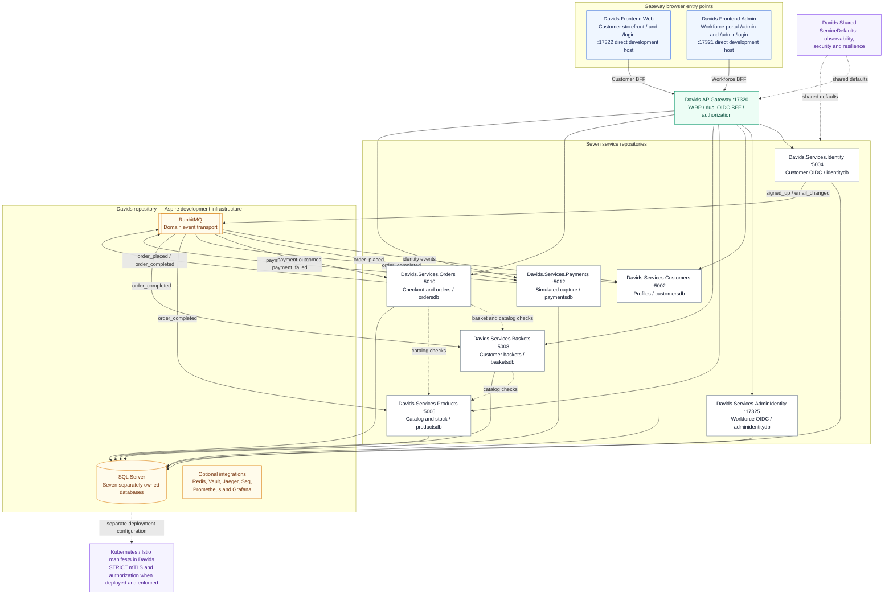

# Davids Platform — Architecture and Security

This document describes the 12-repository development workspace. The vector overview in [`architecture-and-security.svg`](architecture-and-security.svg) is embedded in the [infrastructure README](../README.md); the editable Mermaid source is [`architecture-and-security.mmd`](architecture-and-security.mmd). Both cover the same components and relationships, although their layouts differ.

## Architecture overview



The two frontends are hosted behind the gateway at the same origin. Separate schemes, cookies and authorization policies distinguish customer and workforce sessions, but URL paths do not isolate them from same-origin XSS. Gateway API routes take precedence over the customer fallback. Direct frontend ports are development hosts; use the gateway for authenticated browser flows.

The seven SQL Server databases are separately owned and can share one SQL Server instance. Products seeds its catalog in the local Aspire configuration. Baskets and Orders consult Products; Orders also consults Baskets during checkout. RabbitMQ transports events: Orders publishes `order_placed`, Payments processes it and publishes a capture or failure result, and Orders can then publish `order_completed`. Payment capture is simulated; this is not a production payment-provider integration. Inbox/outbox processing supports retry and deduplication; publisher confirmation alone does not guarantee an event was routed to a consumer.

`Davids` contains the local Aspire AppHost, Vault bootstrap, deployment manifests and lifecycle security tooling. SQL Server and RabbitMQ are provisioned by the local AppHost; Redis, Vault and the observability integrations are configurable. The AppHost is development-only. The Kubernetes/Istio manifests are a separate deployment configuration; STRICT mTLS and mesh authorization apply only when deployed and enforced. The policies include workload-specific rules, not a blanket rule that only the gateway can communicate anywhere in the namespace.

## Customer and workforce sign-in

```mermaid
sequenceDiagram
    actor B as Browser
    participant G as API Gateway
    participant I as Customer Identity or AdminIdentity
    participant API as Backend API
    B->>G: GET /login or /admin/login
    G-->>B: Redirect to matching OIDC login
    B->>I: Authorize with code challenge, state and nonce
    I-->>B: Authorization code and state
    B->>G: Callback with code and state
    G->>I: Backchannel token exchange with PKCE verifier
    I-->>G: ID and access tokens; refresh token if issued
    G-->>B: HttpOnly protected BFF authentication ticket cookie
    B->>G: Request using BFF cookie
    G->>API: Authorized API request with bearer token
```

The gateway uses `SaveTokens`, so the protected ticket carried by the browser can contain tokens; those tokens are not exposed to JavaScript as plaintext by the `HttpOnly` cookie. The cookie is a credential, and XSS can still make authenticated requests. The gateway requires the realm-specific header on unsafe requests and checks `Origin` when it is present. Automatic cookie sliding expiration is disabled; a successful token refresh can nevertheless renew the ticket.

## Security lifecycle

- **Local Dev / Commit:** hooks, secret scanning, dependency auditing and compiler security analysis.
- **Pull Request CI:** CodeQL, Semgrep, infrastructure and supply-chain checks.
- **Staging / Nightly:** seven gateway OpenAPI contracts, realm-partitioned Schemathesis suites, Nuclei and Dastardly.
- **Quarterly / Release:** RESTler, ZAP, authorization matrix and JWT/OIDC boundary checks.
- **Production Cluster:** Kubernetes and Istio security policies, admission controls, runtime monitoring and audit alerting.

Configuration and checked-in manifests describe intended checks; consult workflow results and deployment status before claiming that a particular environment is protected or a particular run passed.

## Exporting diagrams

From the `Davids` directory, use the standalone Mermaid source with [Mermaid Live Editor](https://mermaid.live), or export it with Mermaid CLI:

```powershell
npx -y @mermaid-js/mermaid-cli -i ./docs/architecture-and-security.mmd -o ./docs/architecture-and-security-mermaid.svg -b white
npx -y @mermaid-js/mermaid-cli -i ./docs/architecture-and-security.mmd -o ./docs/architecture-and-security-mermaid.png -w 2600 -s 2 -b white
```

These commands create separate Mermaid-rendered files; they do not overwrite the curated SVG embedded in the README. The curated SVG is independently editable as vector artwork.
