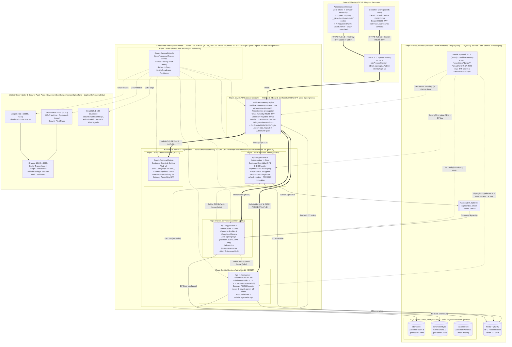
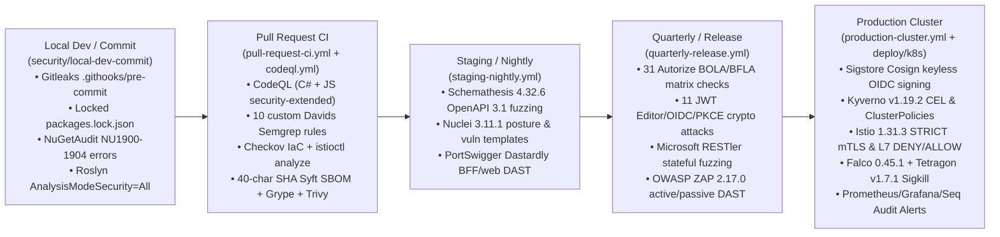

# Davids Platform — Infrastructure, Project Relationships & Security Architecture Diagram

This document provides the **editable diagram sources** and **conversion instructions** for visualizing the seven `.NET 10` repositories, their internal project layers, `.NET Aspire` / Kubernetes + Istio infrastructure dependencies, and every security boundary across the platform.

A pre-rendered, high-resolution vector image is maintained alongside this document at [`docs/architecture-and-security.svg`](architecture-and-security.svg) (and already embedded in [`README.md`](../README.md)), while the standalone Mermaid source is saved at [`docs/architecture-and-security.mmd`](architecture-and-security.mmd).

---

## Converting This Document to an Image (`PNG` / `SVG` / `PDF`) & Embedding in `README.md`

- **Use the included vector diagram directly in `README.md` (no build step required on GitHub)**:
  ```markdown
  
  ```
- **Re-export a high-DPI `PNG` (`2x` retina) or `SVG` from `docs/architecture-and-security.mmd` via Mermaid CLI (`mmdc`)**:
  ```powershell
  npx -y @mermaid-js/mermaid-cli -i ./docs/architecture-and-security.mmd -o ./docs/architecture-and-security.png -w 2600 -s 2 -b "#0b1220"
  npx -y @mermaid-js/mermaid-cli -i ./docs/architecture-and-security.mmd -o ./docs/architecture-and-security.svg -b "#0b1220"
  ```
- **Convert the pre-rendered `docs/architecture-and-security.svg` into a `2x` `PNG` using Inkscape, `rsvg-convert`, or Chromium/Edge**:
  ```powershell
  # Option A — Inkscape CLI
  inkscape ./docs/architecture-and-security.svg --export-type=png --export-filename=./docs/architecture-and-security.png --export-dpi=192

  # Option B — librsvg (Linux / macOS / WSL)
  rsvg-convert -z 2 ./docs/architecture-and-security.svg -o ./docs/architecture-and-security.png

  # Option C — Headless Edge / Chrome (Windows / macOS / Linux)
  msedge --headless --screenshot=./docs/architecture-and-security.png --window-size=1760,1360 ./docs/architecture-and-security.svg
  ```
- **Interactive browser export**: Paste the contents of [`docs/architecture-and-security.mmd`](architecture-and-security.mmd) into [Mermaid Live Editor (`https://mermaid.live`)](https://mermaid.live) and click **Actions -> PNG / SVG**.

---

## 1. Full Infrastructure, 7-Repository Topology & Runtime Security Boundaries



---

## 2. Dual-Authority OIDC PKCE (`S256`), Gateway Admin BFF & Zero-Signing-Key Flow

```mermaid
sequenceDiagram
    autonumber
    actor Admin as Admin Browser
    actor Cust as Customer Client (davids-web)
    participant GW as Davids.APIGateway (:17320)<br/>YARP + Confidential BFF<br/>(Zero Signing Keys)
    participant AdminId as Davids.Services.AdminIdentity (:17325)<br/>OpenIddict RS256 + adminidentitydb
    participant Id as Davids.Services.Identity (:5004)<br/>OpenIddict RS256 + identitydb
    participant Redis as Redis (:6379)<br/>Revoked JTI Cache
    participant CustSvc as Davids.Services.Customers (:5002)<br/>Resource Server + customersdb<br/>(Zero Signing Keys)
    participant FE as Davids.Frontend.Admin (:17321)<br/>Admin UI

    rect rgb(23, 37, 84)
    Note over Admin,FE: Administrator Flow — Confidential OIDC BFF (No Access/Refresh Tokens in Browser JS)
    Admin->>GW: GET / -> 302 /login -> /auth/login (generates PKCE S256 verifier + state)
    GW->>AdminId: /admin-identity/connect/authorize (client_id=davids-admin-bff, code_challenge_method=S256)
    Admin->>AdminId: POST credentials + hidden antiforgery request_token
    AdminId-->>GW: 302 /signin-oidc?code=... (single-use auth code)
    GW->>AdminId: POST /connect/token (code + code_verifier + client_secret)
    AdminId-->>GW: RS256 Access Token (role=admin, aud=davids-admin) + Rotating Refresh Token
    GW-->>Admin: Set-Cookie: __Host-Davids.Admin.Bff (Encrypted DataProtection, HttpOnly, Secure, SameSite=Lax)
    Admin->>GW: GET / + PUT /api/admin/customers/{id} (Cookie + X-Requested-With: DavidsAdmin + Origin)
    GW->>Redis: Verify token JTI not revoked
    GW->>FE: Proxy static/UI request (role=admin verified, Istio STRICT mTLS)
    GW->>CustSvc: Proxy /customers/* with upstream Admin RS256 Bearer token (Istio STRICT mTLS)
    CustSvc->>AdminId: Validate signature against cached public /.well-known/jwks
    end

    rect rgb(15, 23, 42)
    Note over Cust,CustSvc: Customer Flow — Public OIDC Client with PKCE S256 & Tenant Self-Service Boundary
    Cust->>GW: GET/POST /identity/connect/authorize (client_id=davids-web, PKCE S256)
    GW->>Id: Forward OIDC PKCE authorization & token exchange
    Id-->>Cust: RS256 Access Token (role=user, aud=davids-services, sub=customerGuid)
    Cust->>GW: POST /customers or GET /customers/{ownId} (Authorization: Bearer <CustomerRS256>)
    GW->>Redis: Verify token JTI not revoked
    GW->>CustSvc: Forward verified Customer RS256 Bearer token (cross-customer ID -> 403, admin routes -> 403)
    Cust->>GW: POST /identity/connect/revocation (RFC 7009)
    GW->>Id: Revoke grant & publish JTI TTL to Redis
    Id->>Redis: Store revoked JTI -> immediate 401 across Gateway
    end
```



---

## 3. Continuous 5-Stage Lifecycle Security Verification Pipeline



---

## 4. Repository, Project & Security Boundary Summary

- **`Davids` (`Davids.slnx` — Aggregate Orchestration, Bootstrap, Kubernetes/Istio Manifests & Lifecycle Security Suite)**:
  - `src/Davids.AppHost` orchestrates all five runtime services alongside SQL Server, Redis, RabbitMQ, HashiCorp Vault, Prometheus, Jaeger, Grafana, and Seq (plus opt-in InfluxDB and Elasticsearch/Kibana) for local `.NET Aspire` development.
  - `src/Davids.Bootstrap` initializes HashiCorp Vault KV-v2 (`secret/data/davids/{identity,admin-identity,customers,gateway}`) with separate 2048-bit RSA OIDC signing/encryption keys per authority, the confidential `davids-admin-bff` secret, and isolated ASP.NET Core DataProtection master keys before dependent services start.
  - `deploy/k8s/` defines production Kubernetes manifests, `STRICT` Istio mTLS & L7 `AuthorizationPolicy` manifests, Kyverno `ClusterPolicy` + CEL `ValidatingPolicy` admission rules, Falco + Cilium Tetragon eBPF runtime policies, Prometheus `PrometheusRule` alerts, and Secret-backed Grafana provisioning.
- **`Davids.Shared` (`Davids.Shared.slnx` — Shared Observability, Resilience & Security Audit Telemetry)**:
  - `src/Davids.ServiceDefaults` is consumed by all five runtime services (via local project reference when cloned side-by-side or via NuGet package `Davids.ServiceDefaults` when `UseSharedPackageReference=true` so every service repository builds standalone).
  - Wires OpenTelemetry distributed tracing (Jaeger OTLP), metrics (Prometheus OTLP + `Davids.Security.Audit` security counters), structured Serilog logging (Seq CLEF + optional Elasticsearch), `/health` and `/alive` probes, and HTTP resilience defaults.
- **`Davids.APIGateway` (`Davids.APIGateway.slnx` — Edge Reverse Proxy, Dual-Authority JWT Verifier & Admin OIDC BFF, `:17320`)**:
  - Clean layers: `Davids.APIGateway.Api` -> `Davids.APIGateway.Infrastructure` -> `Davids.ServiceDefaults`.
  - Routes directly to backend services via **YARP `2.3.0`** (with Istio handling cluster mTLS and service mesh traffic management), stamps correlation IDs, propagates W3C `traceparent` spans, enforces per-route sliding-window rate limits, checks Redis for RFC 7009 revoked token JTIs, validates Customer and Admin `RS256` tokens via public JWKS (**holds zero signing keys**), and hosts the confidential Admin OIDC BFF (`davids_admin_bff` encrypted `HttpOnly` cookie + `X-Requested-With: DavidsAdmin` and `Origin` CSRF validation) enforcing `role = admin` before any request reaches `Davids.Frontend.Admin`.
- **`Davids.Services.Identity` (`Davids.Services.Identity.slnx` — Customer OIDC Provider, `:5004`)**:
  - Clean layers: `Api` -> `Application` + `Infrastructure` -> `Core` (+ `Davids.ServiceDefaults`).
  - Self-hosted **OpenIddict `7.7.2`** OAuth 2.1 / OIDC authority for customer accounts (`davids-web` public client with mandatory PKCE `S256`, antiforgery `request_token` on `/connect/authorize`, asymmetric `RS256` access tokens, single-use rotating refresh tokens with reuse cascade revocation, and RFC 7009 revocation synced to Redis).
  - Exclusively owns SQL Server database **`identitydb`** and publishes `SignedUp` integration events to RabbitMQ.
- **`Davids.Services.AdminIdentity` (`Davids.Services.AdminIdentity.slnx` — Administrator OIDC Provider, `:17325`)**:
  - Clean layers: `Api` -> `Application` + `Infrastructure` -> `Core` (+ `Davids.ServiceDefaults`).
  - Physically and cryptographically isolated **OpenIddict `7.7.2`** authority for administrators (`role = admin`, confidential client `davids-admin-bff`, independent RSA signing/encryption keys, separate issuer, account lockout protection, and `AdminLoginAuditLogs`).
  - Exclusively owns SQL Server database **`adminidentitydb`** — customer and administrator credentials never share a database, table, or signing key.
- **`Davids.Services.Customers` (`Davids.Services.Customers.slnx` — Customer Domain & Order Tracking Service, `:5002`)**:
  - Clean layers: `Api` -> `Application` + `Infrastructure` -> `Core` (+ `Davids.ServiceDefaults`); `Davids.Services.Customers.Application` is the backend CQRS/application layer.
  - Holds **zero signing keys**, validating `CustomerBearer` and `AdminBearer` `RS256` JWTs via public JWKS discovery, consuming RabbitMQ events into **`customersdb`**, restricting customers to their own profile while requiring `AdminOnly` (`role = admin` from `AdminIdentity`) for customer search, listing, and editing.
- **`Davids.Frontend.Admin` (`Davids.Frontend.Admin.slnx` — Administrator Customer Search & Editing Web UI, `:17321`)**:
  - Serves the administrator interface behind strict Content-Security-Policy (`default-src 'self'; script-src 'self'; frame-ancestors 'none'`), reachable only through `Davids.APIGateway` after `AdminOnly` BFF session verification and restricted in-cluster by Istio `AuthorizationPolicy` exclusively to principal `cluster.local/ns/davids/sa/davids-api-gateway`.
